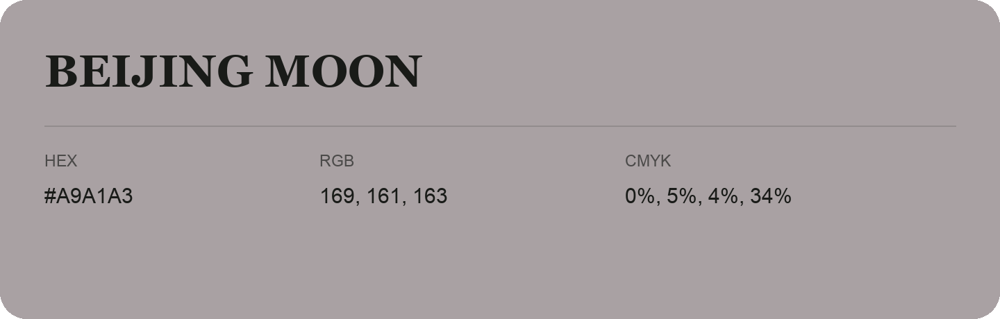

## Beijing Moon

- HEX: #A9A1A3
- RGB: 169, 161, 163
- CMYK: 0%, 5%, 4%, 34%
- Character: quiet, balanced, understated
- Suggested uses: professional services, minimal identities, supporting backgrounds

- Source images: IMG_9014.JPG

- Name note: Other distinct shades share this name: [beijing-moon-aaa2a1](beijing-moon-aaa2a1.md).
