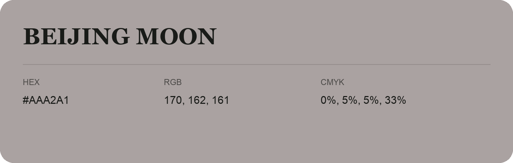

## Beijing Moon

- HEX: #AAA2A1
- RGB: 170, 162, 161
- CMYK: 0%, 5%, 5%, 33%
- Character: quiet, balanced, understated
- Suggested uses: professional services, minimal identities, supporting backgrounds

- Source images: IMG_9105.JPG

- Data provenance: HEX recovered from page data; cross-checked against the readable source RGB.

- Name note: Other distinct shades share this name: [beijing-moon-a9a1a3](beijing-moon-a9a1a3.md).
