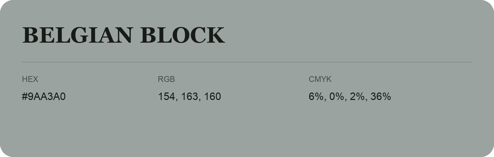

## Belgian Block

- HEX: #9AA3A0
- RGB: 154, 163, 160
- CMYK: 6%, 0%, 2%, 36%
- Character: quiet, balanced, understated
- Suggested uses: professional services, minimal identities, supporting backgrounds

- Source images: IMG_9038.JPG

- Data provenance: HEX recovered from page data; cross-checked against the recognized source text with visually equivalent glyphs.
- Data provenance: RGB calculated from HEX, matching the page; source image RGB was unreadable.
