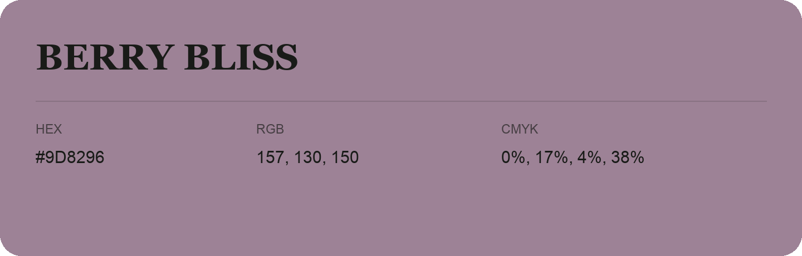

## Berry Bliss

- HEX: #9D8296
- RGB: 157, 130, 150
- CMYK: 0%, 17%, 4%, 38%
- Character: expressive, imaginative, refined
- Suggested uses: beauty brands, creative businesses, distinctive accents

- Source images: IMG_9102.JPG
