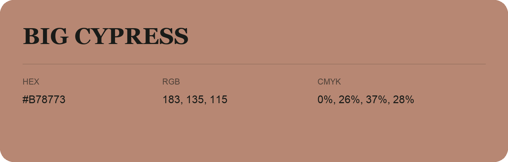

## Big Cypress

- HEX: #B78773
- RGB: 183, 135, 115
- CMYK: 0%, 26%, 37%, 28%
- Character: earthy, rich, warm
- Suggested uses: artisan businesses, hospitality brands, warm accents

- Source images: IMG_9063.JPG

- Data provenance: RGB calculated from HEX, matching the page; source image RGB was unreadable.
