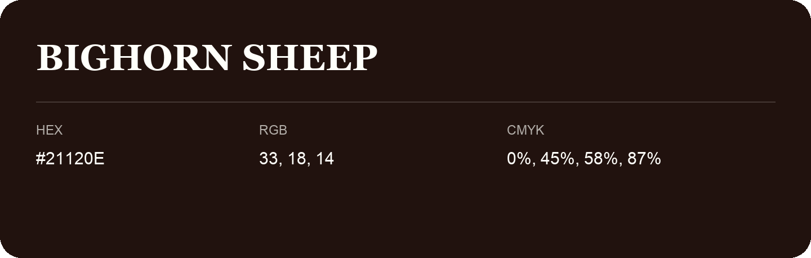

## Bighorn Sheep

- HEX: #21120E
- RGB: 33, 18, 14
- CMYK: 0%, 45%, 58%, 87%
- Character: warm, expressive, energetic
- Suggested uses: food brands, expressive identities, promotional accents

- Source images: IMG_8976.JPG
