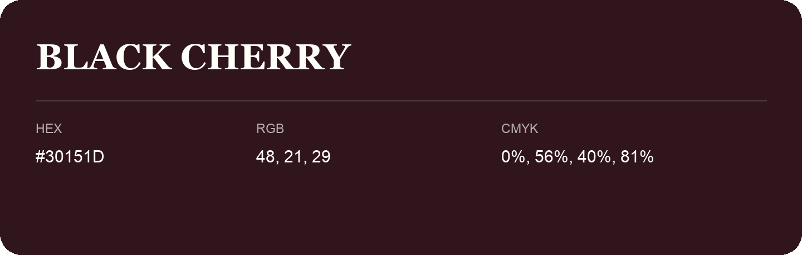

## Black Cherry

- HEX: #30151D
- RGB: 48, 21, 29
- CMYK: 0%, 56%, 40%, 81%
- Character: expressive, imaginative, refined
- Suggested uses: beauty brands, creative businesses, distinctive accents

- Source images: IMG_9109.JPG
