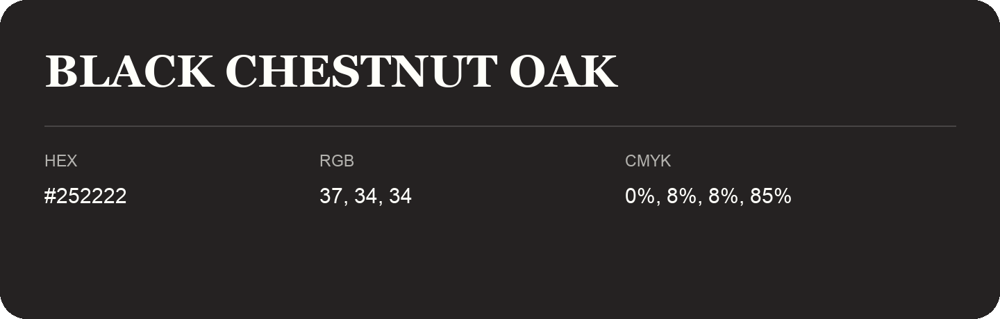

## Black Chestnut Oak

- HEX: #252222
- RGB: 37, 34, 34
- CMYK: 0%, 8%, 8%, 85%
- Character: restrained, grounded, sophisticated
- Suggested uses: premium brands, editorial typography, dark backgrounds

- Source images: IMG_9034.JPG
