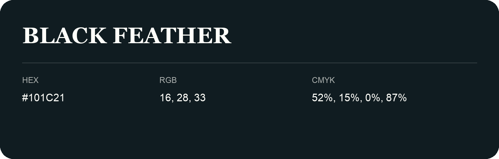

## Black Feather

- HEX: #101C21
- RGB: 16, 28, 33
- CMYK: 52%, 15%, 0%, 87%
- Character: deep, grounded, understated
- Suggested uses: premium packaging, editorial typography, dark backgrounds

- Source images: iCloud Photos 2/IMG_9149.JPG

- Name note: Other distinct shades share this name: [black-feather](black-feather.md).
