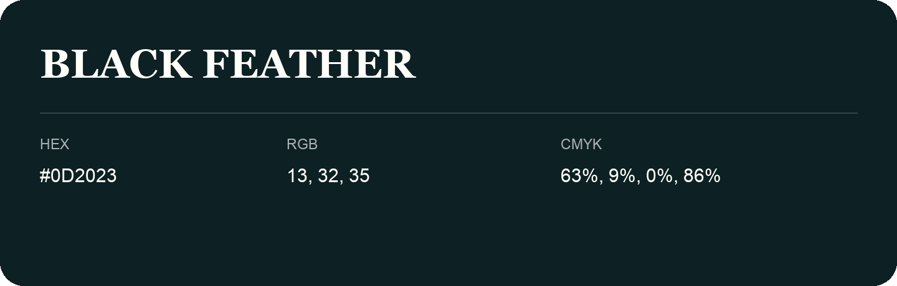

## Black Feather

- HEX: #0D2023
- RGB: 13, 32, 35
- CMYK: 63%, 9%, 0%, 86%
- Character: calm, fresh, composed
- Suggested uses: wellness brands, coastal hospitality, modern service brands

- Source images: IMG_9091.JPG

- Data provenance: HEX recovered from page data; cross-checked against the readable source RGB.

- Name note: Other distinct shades share this name: [black-feather-101c21](black-feather-101c21.md).
