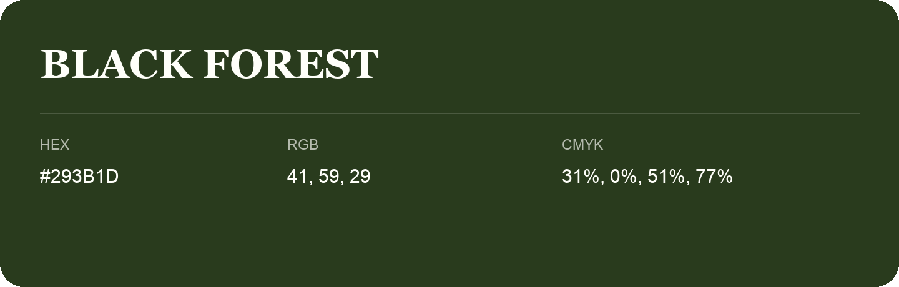

## Black Forest

- HEX: #293B1D
- RGB: 41, 59, 29
- CMYK: 31%, 0%, 51%, 77%
- Character: natural, grounded, fresh
- Suggested uses: outdoor businesses, wellness brands, organic packaging

- Source images: IMG_8991.JPG

- Data provenance: HEX recovered from page data; cross-checked against the readable source RGB.
