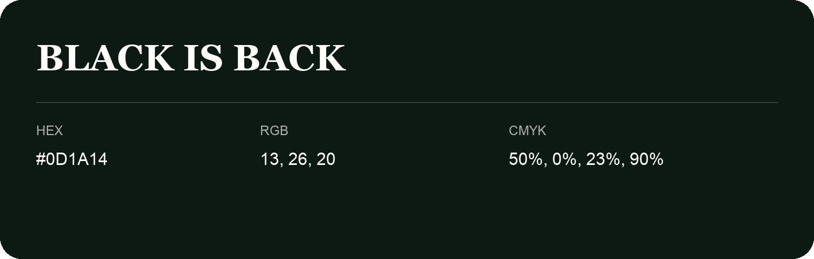

## Black Is Back

- HEX: #0D1A14
- RGB: 13, 26, 20
- CMYK: 50%, 0%, 23%, 90%
- Character: cool, composed, dependable
- Suggested uses: professional services, technology brands, calm backgrounds

- Source images: IMG_9079.JPG

- Data provenance: HEX recovered from page data; cross-checked against the readable source RGB.

- Name note: Other distinct shades share this name: [black-is-back-11141b](black-is-back-11141b.md), [black-is-back-11151a](black-is-back-11151a.md).
