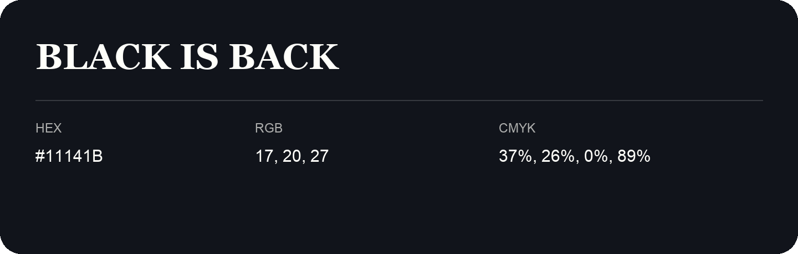

## Black Is Back

- HEX: #11141B
- RGB: 17, 20, 27
- CMYK: 37%, 26%, 0%, 89%
- Character: deep, grounded, understated
- Suggested uses: premium packaging, editorial typography, dark backgrounds

- Source images: iCloud Photos 2/IMG_9133.JPG

- Name note: Other distinct shades share this name: [black-is-back-0d1a14](black-is-back-0d1a14.md), [black-is-back-11151a](black-is-back-11151a.md).
