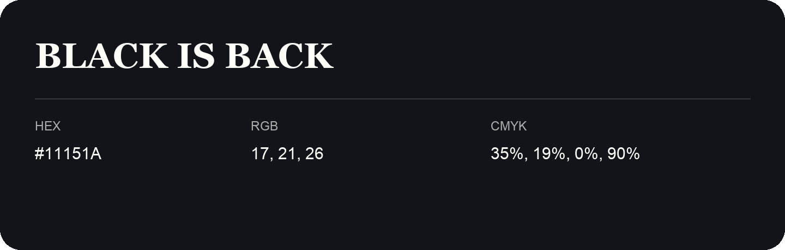

## Black Is Back

- HEX: #11151A
- RGB: 17, 21, 26
- CMYK: 35%, 19%, 0%, 90%
- Character: deep, grounded, understated
- Suggested uses: premium packaging, editorial typography, dark backgrounds

- Source images: IMG_9066.JPG

- Name note: Other distinct shades share this name: [black-is-back-0d1a14](black-is-back-0d1a14.md), [black-is-back-11141b](black-is-back-11141b.md).
