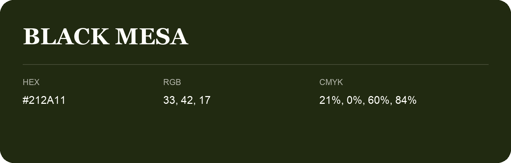

## Black Mesa

- HEX: #212A11
- RGB: 33, 42, 17
- CMYK: 21%, 0%, 60%, 84%
- Character: deep, grounded, understated
- Suggested uses: premium packaging, editorial typography, dark backgrounds

- Source images: IMG_9024.JPG

- Name note: Other distinct shades share this name: [black-mesa-21200b](black-mesa-21200b.md), [black-mesa-21250f](black-mesa-21250f.md), [black-mesa-251f13](black-mesa-251f13.md), [black-mesa-252a12](black-mesa-252a12.md), [black-mesa-272515](black-mesa-272515.md), [black-mesa-282414](black-mesa-282414.md).
