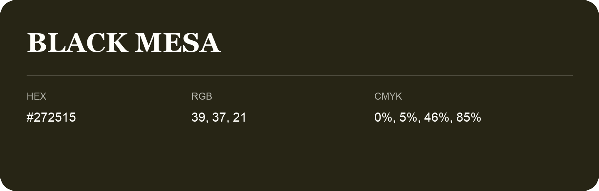

## Black Mesa

- HEX: #272515
- RGB: 39, 37, 21
- CMYK: 0%, 5%, 46%, 85%
- Character: deep, grounded, understated
- Suggested uses: premium packaging, editorial typography, dark backgrounds

- Source images: IMG_9056.JPG

- Name note: Other distinct shades share this name: [black-mesa-21200b](black-mesa-21200b.md), [black-mesa-21250f](black-mesa-21250f.md), [black-mesa-212a11](black-mesa-212a11.md), [black-mesa-251f13](black-mesa-251f13.md), [black-mesa-252a12](black-mesa-252a12.md), [black-mesa-282414](black-mesa-282414.md).
