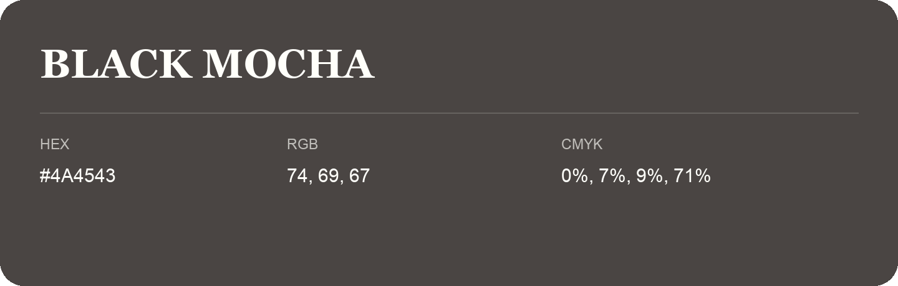

## Black Mocha

- HEX: #4A4543
- RGB: 74, 69, 67
- CMYK: 0%, 7%, 9%, 71%
- Character: restrained, grounded, sophisticated
- Suggested uses: premium brands, editorial typography, dark backgrounds

- Source images: IMG_9007.JPG
