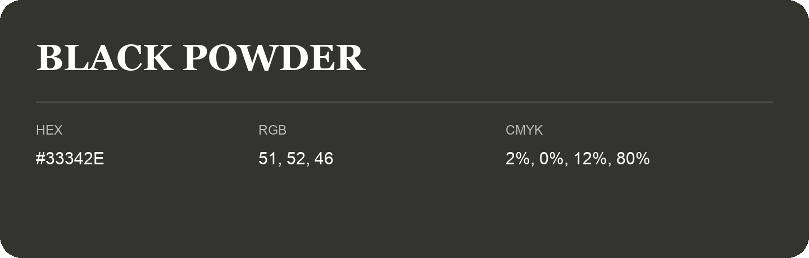

## Black Powder

- HEX: #33342E
- RGB: 51, 52, 46
- CMYK: 2%, 0%, 12%, 80%
- Character: deep, grounded, understated
- Suggested uses: premium packaging, editorial typography, dark backgrounds

- Source images: iCloud Photos 2/IMG_9160.JPG
