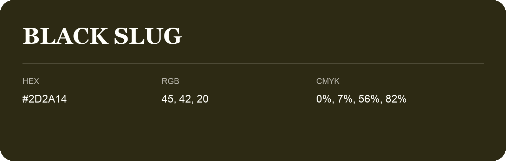

## Black Slug

- HEX: #2D2A14
- RGB: 45, 42, 20
- CMYK: 0%, 7%, 56%, 82%
- Character: deep, grounded, understated
- Suggested uses: premium packaging, editorial typography, dark backgrounds

- Source images: IMG_9044.JPG

- Name note: Other distinct shades share this name: [black-slug-2e2914](black-slug-2e2914.md), [black-slug-33240a](black-slug-33240a.md).
