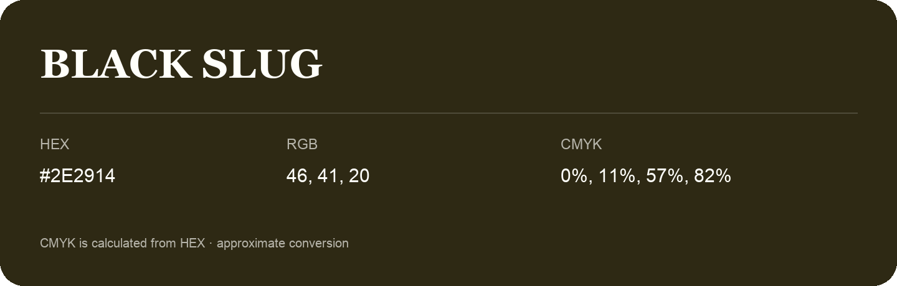

## Black Slug

- HEX: #2E2914
- RGB: 46, 41, 20
- CMYK: 0%, 11%, 57%, 82%
- Character: deep, grounded, understated
- Suggested uses: premium packaging, editorial typography, dark backgrounds

- Source images: IMG_8997.JPG

- Data provenance: CMYK calculated from HEX using the page’s conversion; source image CMYK was unreadable. This is an approximate conversion without a print color profile.

- Name note: Other distinct shades share this name: [black-slug-2d2a14](black-slug-2d2a14.md), [black-slug-33240a](black-slug-33240a.md).
