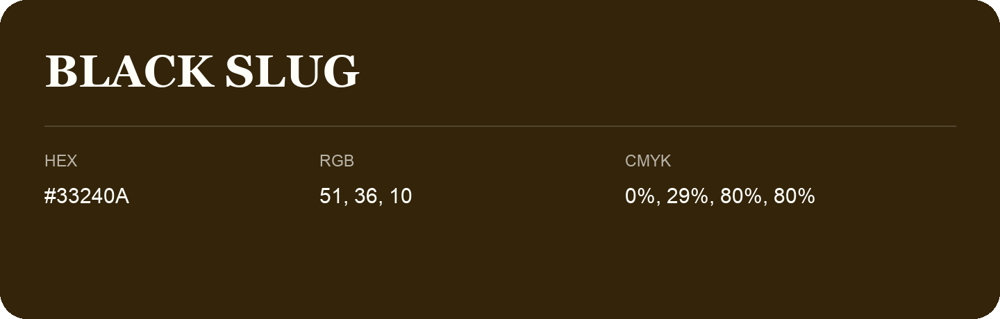

## Black Slug

- HEX: #33240A
- RGB: 51, 36, 10
- CMYK: 0%, 29%, 80%, 80%
- Character: deep, grounded, understated
- Suggested uses: premium packaging, editorial typography, dark backgrounds

- Source images: IMG_9105.JPG

## Consolidated source variants

This is the canonical library entry. Same-name variants below are within ΔE00 ≤ 1 of this shade and were consolidated editorially. Their source values are preserved; they were not source errors.

### Source variant #33250E

- HEX: #33250E
- RGB: 51, 37, 14
- CMYK: 0%, 27%, 73%, 80%
- Difference from canonical: ΔE00 0.8242.
- Source images: iCloud Photos 2/IMG_9153.JPG

- Name note: Other distinct shades share this name: [black-slug-2d2a14](black-slug-2d2a14.md), [black-slug-2e2914](black-slug-2e2914.md).
