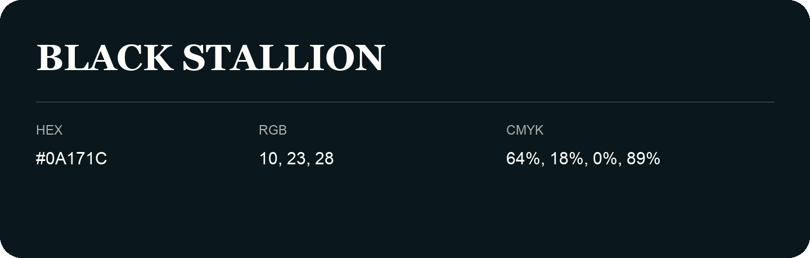

## Black Stallion

- HEX: #0A171C
- RGB: 10, 23, 28
- CMYK: 64%, 18%, 0%, 89%
- Character: calm, fresh, composed
- Suggested uses: wellness brands, coastal hospitality, modern service brands

- Source images: IMG_9039.JPG

- Data provenance: HEX recovered from page data; cross-checked against the readable source RGB.

- Name note: Other distinct shades share this name: [black-stallion-0a1b20](black-stallion-0a1b20.md), [black-stallion-0e171c](black-stallion-0e171c.md).
