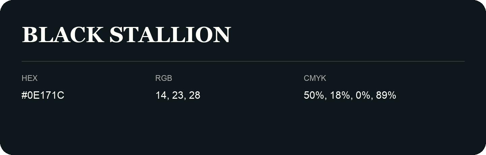

## Black Stallion

- HEX: #0E171C
- RGB: 14, 23, 28
- CMYK: 50%, 18%, 0%, 89%
- Character: deep, grounded, understated
- Suggested uses: premium packaging, editorial typography, dark backgrounds

- Source images: iCloud Photos 2/IMG_9159.JPG

- Name note: Other distinct shades share this name: [black-stallion-0a171c](black-stallion-0a171c.md), [black-stallion-0a1b20](black-stallion-0a1b20.md).
