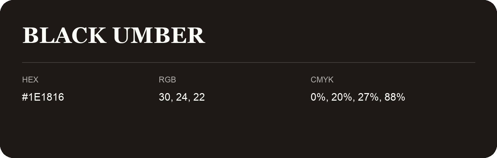

## Black Umber

- HEX: #1E1816
- RGB: 30, 24, 22
- CMYK: 0%, 20%, 27%, 88%
- Character: deep, grounded, understated
- Suggested uses: premium packaging, editorial typography, dark backgrounds

- Source images: iCloud Photos 2/IMG_9188.JPG
