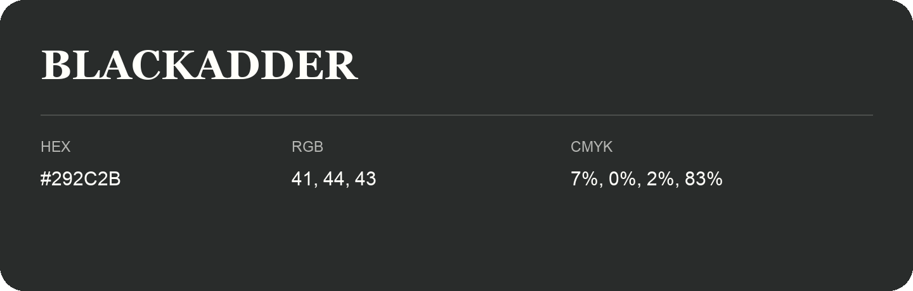

## Blackadder

- HEX: #292C2B
- RGB: 41, 44, 43
- CMYK: 7%, 0%, 2%, 83%
- Character: restrained, grounded, sophisticated
- Suggested uses: premium brands, editorial typography, dark backgrounds

- Source images: IMG_9076.JPG
