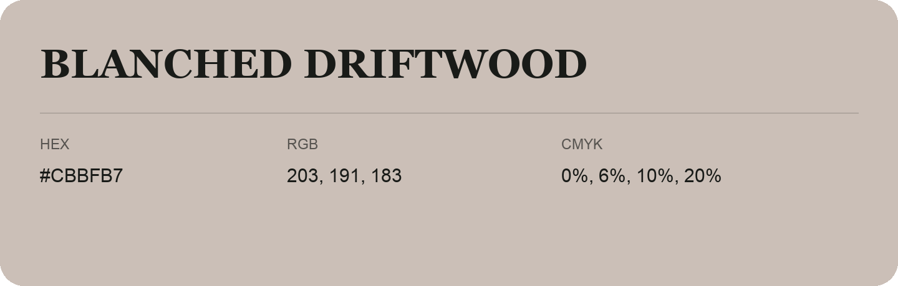

## Blanched Driftwood

- HEX: #CBBFB7
- RGB: 203, 191, 183
- CMYK: 0%, 6%, 10%, 20%
- Character: quiet, balanced, understated
- Suggested uses: professional services, minimal identities, supporting backgrounds

- Source images: IMG_9113.JPG
