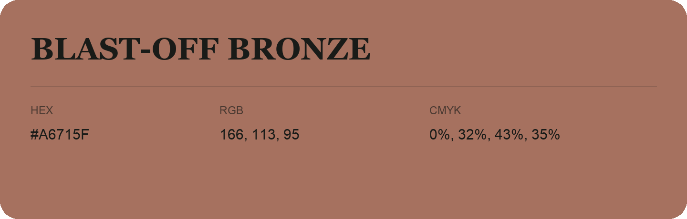

## Blast-Off Bronze

- HEX: #A6715F
- RGB: 166, 113, 95
- CMYK: 0%, 32%, 43%, 35%
- Character: earthy, rich, warm
- Suggested uses: artisan businesses, hospitality brands, warm accents

- Source images: IMG_9008.JPG
