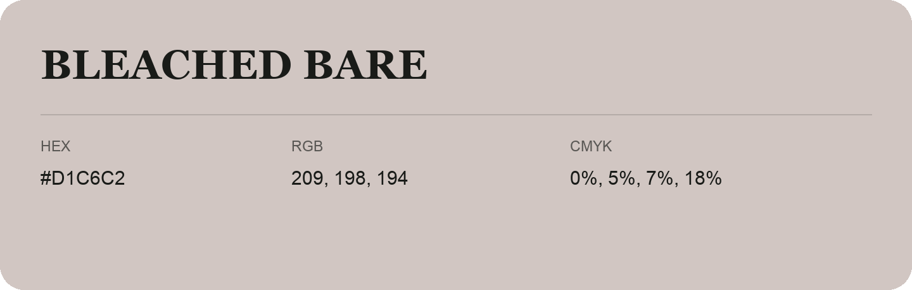

## Bleached Bare

- HEX: #D1C6C2
- RGB: 209, 198, 194
- CMYK: 0%, 5%, 7%, 18%
- Character: quiet, balanced, understated
- Suggested uses: professional services, minimal identities, supporting backgrounds

- Source images: iCloud Photos 2/IMG_9144.JPG
