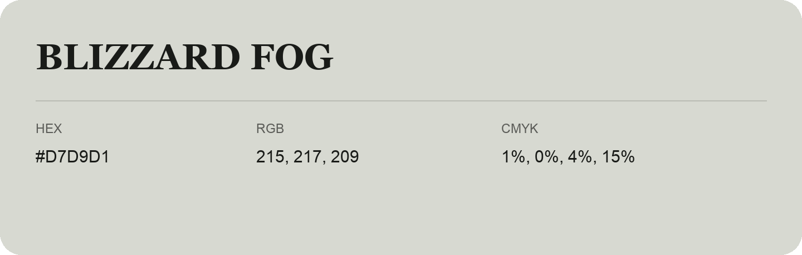

## Blizzard Fog

- HEX: #D7D9D1
- RGB: 215, 217, 209
- CMYK: 1%, 0%, 4%, 15%
- Character: quiet, balanced, understated
- Suggested uses: professional services, minimal identities, supporting backgrounds

- Source images: IMG_9100.JPG
