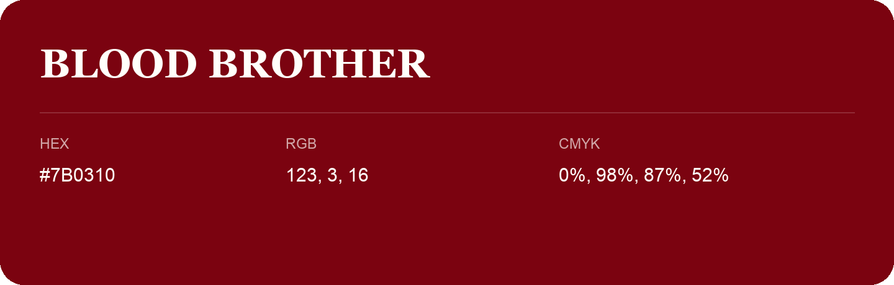

## Blood Brother

- HEX: #7B0310
- RGB: 123, 3, 16
- CMYK: 0%, 98%, 87%, 52%
- Character: warm, expressive, energetic
- Suggested uses: food brands, expressive identities, promotional accents

- Source images: IMG_9075.JPG
