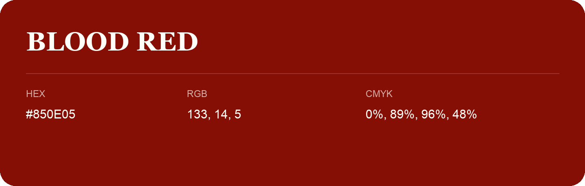

## Blood Red

- HEX: #850E05
- RGB: 133, 14, 5
- CMYK: 0%, 89%, 96%, 48%
- Character: warm, expressive, energetic
- Suggested uses: food brands, expressive identities, promotional accents

- Source images: IMG_8988.JPG
