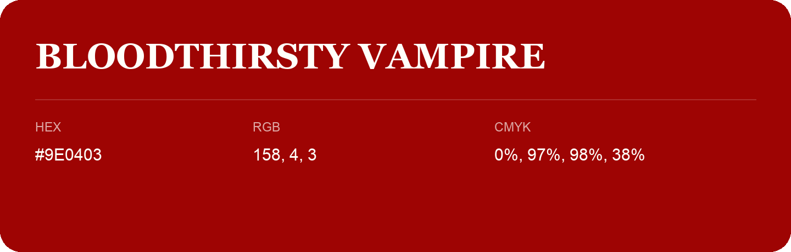

## Bloodthirsty Vampire

- HEX: #9E0403
- RGB: 158, 4, 3
- CMYK: 0%, 97%, 98%, 38%
- Character: warm, expressive, energetic
- Suggested uses: food brands, expressive identities, promotional accents

- Source images: iCloud Photos 2/IMG_9169.JPG
