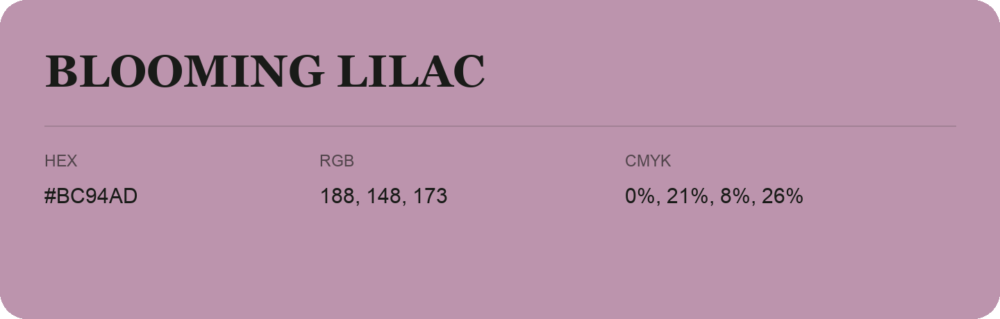

## Blooming Lilac

- HEX: #BC94AD
- RGB: 188, 148, 173
- CMYK: 0%, 21%, 8%, 26%
- Character: expressive, imaginative, refined
- Suggested uses: beauty brands, creative businesses, distinctive accents

- Source images: iCloud Photos 2/IMG_9161.JPG
