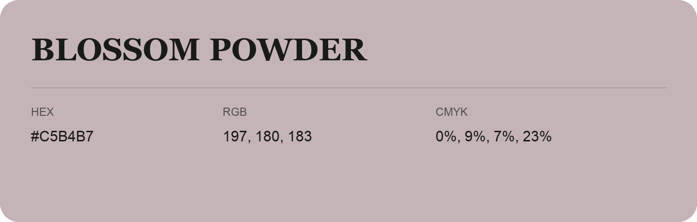

## Blossom Powder

- HEX: #C5B4B7
- RGB: 197, 180, 183
- CMYK: 0%, 9%, 7%, 23%
- Character: quiet, balanced, understated
- Suggested uses: professional services, minimal identities, supporting backgrounds

- Source images: IMG_9064.JPG
