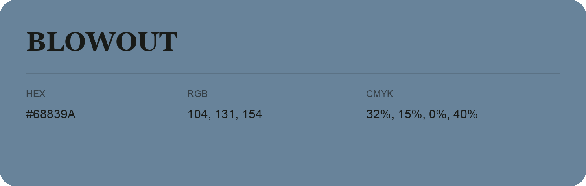

## Blowout

- HEX: #68839A
- RGB: 104, 131, 154
- CMYK: 32%, 15%, 0%, 40%
- Character: cool, composed, dependable
- Suggested uses: professional services, technology brands, calm backgrounds

- Source images: iCloud Photos 2/IMG_9145.JPG
