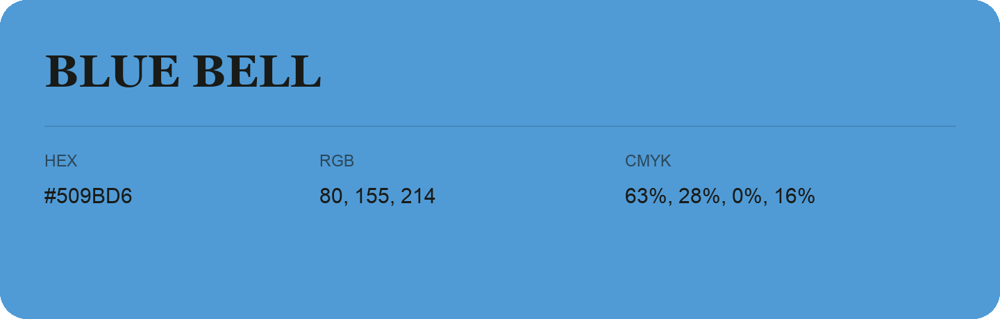

## Blue Bell

- HEX: #509BD6
- RGB: 80, 155, 214
- CMYK: 63%, 28%, 0%, 16%
- Character: cool, composed, dependable
- Suggested uses: professional services, technology brands, calm backgrounds

- Source images: IMG_8990.JPG
