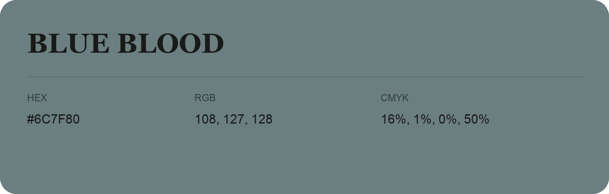

## Blue Blood

- HEX: #6C7F80
- RGB: 108, 127, 128
- CMYK: 16%, 1%, 0%, 50%
- Character: calm, fresh, composed
- Suggested uses: wellness brands, coastal hospitality, modern service brands

- Source images: IMG_9010.JPG
