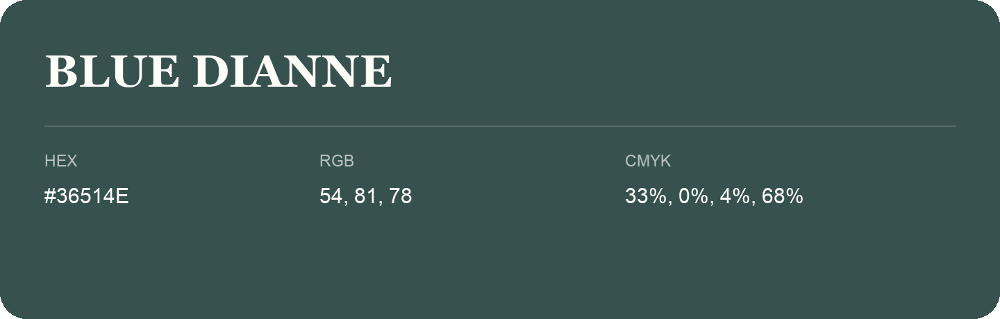

## Blue Dianne

- HEX: #36514E
- RGB: 54, 81, 78
- CMYK: 33%, 0%, 4%, 68%
- Character: deep, grounded, understated
- Suggested uses: premium packaging, editorial typography, dark backgrounds

- Source images: iCloud Photos 2/IMG_9176.JPG
