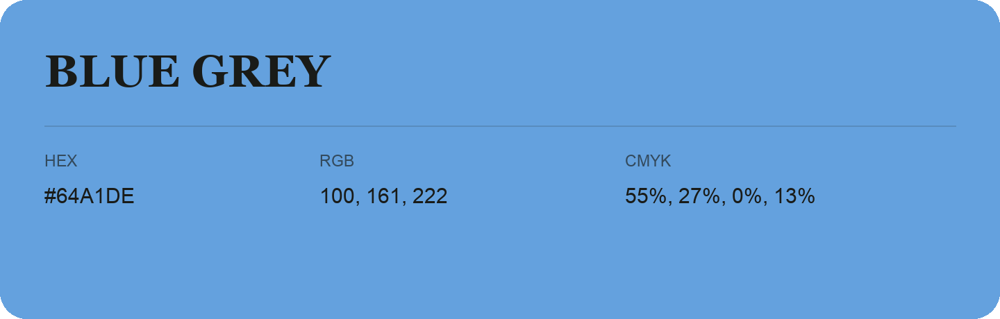

## Blue Grey

- HEX: #64A1DE
- RGB: 100, 161, 222
- CMYK: 55%, 27%, 0%, 13%
- Character: cool, composed, dependable
- Suggested uses: professional services, technology brands, calm backgrounds

- Source images: IMG_8984.JPG

- Data provenance: HEX recovered from page data; cross-checked against the readable source RGB.
