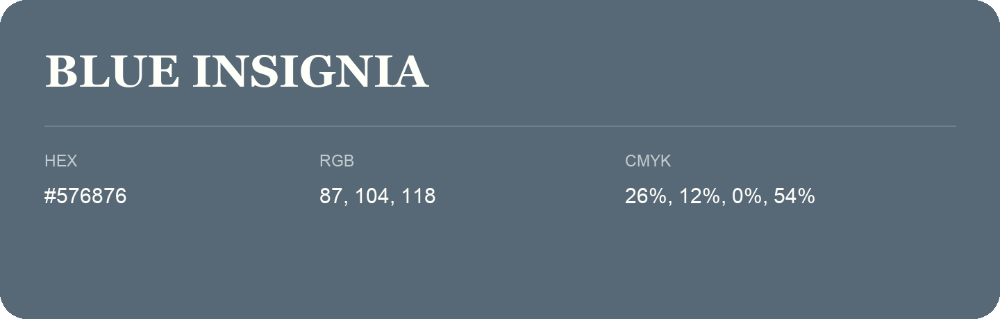

## Blue Insignia

- HEX: #576876
- RGB: 87, 104, 118
- CMYK: 26%, 12%, 0%, 54%
- Character: cool, composed, dependable
- Suggested uses: professional services, technology brands, calm backgrounds

- Source images: IMG_9034.JPG

- Data provenance: RGB calculated from HEX, matching the page; source image RGB was unreadable.
