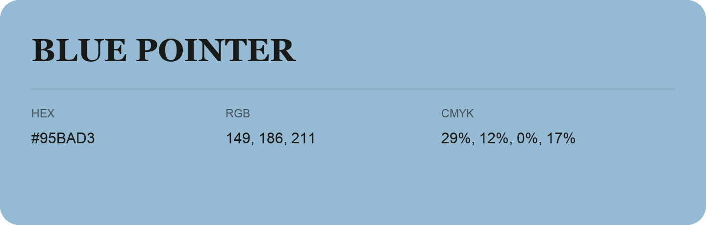

## Blue Pointer

- HEX: #95BAD3
- RGB: 149, 186, 211
- CMYK: 29%, 12%, 0%, 17%
- Character: soft, gentle, approachable
- Suggested uses: friendly consumer brands, gentle backgrounds, welcoming accents

- Source images: IMG_9103.JPG
