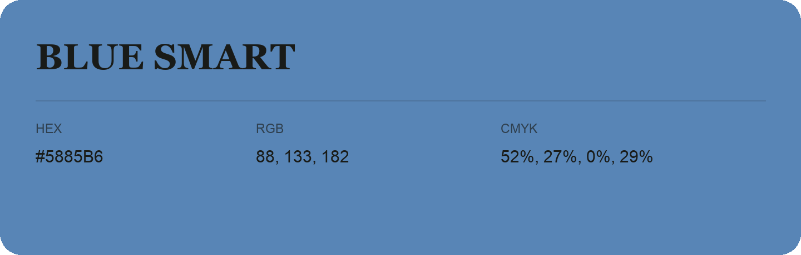

## Blue Smart

- HEX: #5885B6
- RGB: 88, 133, 182
- CMYK: 52%, 27%, 0%, 29%
- Character: cool, composed, dependable
- Suggested uses: professional services, technology brands, calm backgrounds

- Source images: IMG_9012.JPG

- Data provenance: RGB calculated from HEX, matching the page; source image RGB was unreadable.

## Consolidated source variants

This is the canonical library entry. Same-name variants below are within ΔE00 ≤ 1 of this shade and were consolidated editorially. Their source values are preserved; they were not source errors.

### Source variant #5985B5

- HEX: #5985B5
- RGB: 89, 133, 181
- CMYK: 51%, 27%, 0%, 29%
- Difference from canonical: ΔE00 0.1999.
- Source images: IMG_9072.JPG
