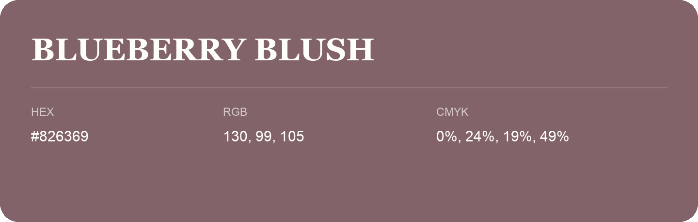

## Blueberry Blush

- HEX: #826369
- RGB: 130, 99, 105
- CMYK: 0%, 24%, 19%, 49%
- Character: warm, expressive, energetic
- Suggested uses: food brands, expressive identities, promotional accents

- Source images: IMG_9096.JPG

- Data provenance: RGB calculated from HEX, matching the page; source image RGB was unreadable.
