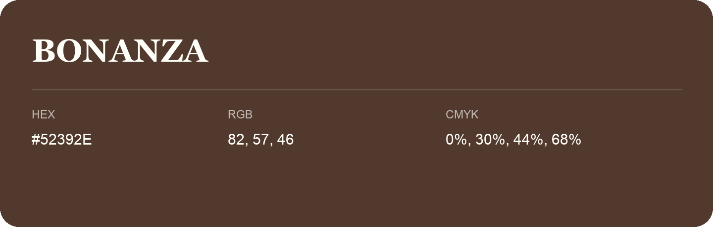

## Bonanza

- HEX: #52392E
- RGB: 82, 57, 46
- CMYK: 0%, 30%, 44%, 68%
- Character: earthy, rich, warm
- Suggested uses: premium packaging, rustic brands, dark backgrounds

- Source images: IMG_9017.JPG
