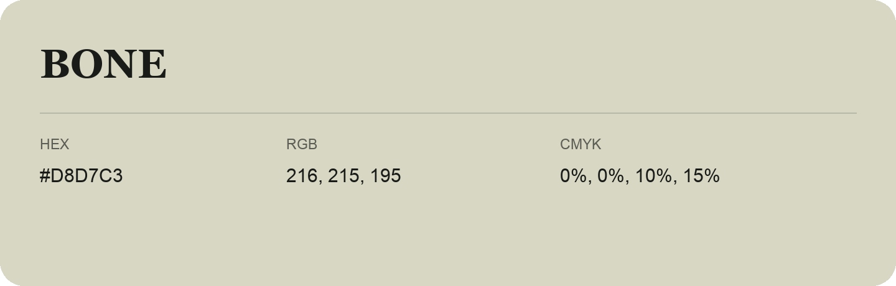

## Bone

- HEX: #D8D7C3
- RGB: 216, 215, 195
- CMYK: 0%, 0%, 10%, 15%
- Character: quiet, balanced, understated
- Suggested uses: professional services, minimal identities, supporting backgrounds

- Source images: IMG_8989.JPG
