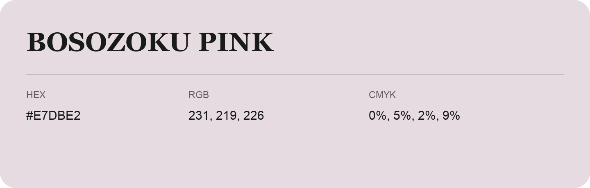

## Bosozoku Pink

- HEX: #E7DBE2
- RGB: 231, 219, 226
- CMYK: 0%, 5%, 2%, 9%
- Character: quiet, balanced, understated
- Suggested uses: professional services, minimal identities, supporting backgrounds

- Source images: iCloud Photos 2/IMG_9146.JPG
- Data provenance: RGB calculated from HEX; source text recognition was uncertain.
