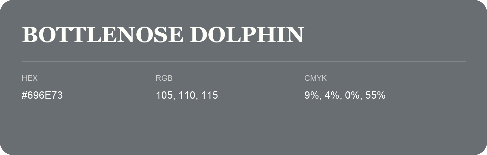

## Bottlenose Dolphin

- HEX: #696E73
- RGB: 105, 110, 115
- CMYK: 9%, 4%, 0%, 55%
- Character: restrained, grounded, sophisticated
- Suggested uses: premium brands, editorial typography, dark backgrounds

- Source images: IMG_9022.JPG

- Name note: Other distinct shades share this name: [bottlenose-dolphin-6a7174](bottlenose-dolphin-6a7174.md).
