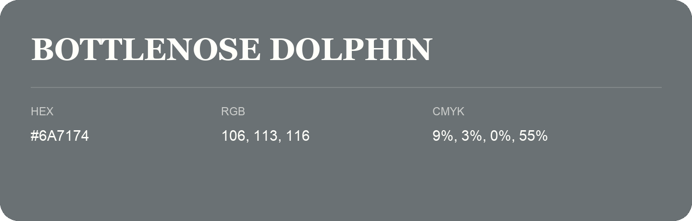

## Bottlenose Dolphin

- HEX: #6A7174
- RGB: 106, 113, 116
- CMYK: 9%, 3%, 0%, 55%
- Character: restrained, grounded, sophisticated
- Suggested uses: premium brands, editorial typography, dark backgrounds

- Source images: IMG_9107.JPG

- Name note: Other distinct shades share this name: [bottlenose-dolphin-696e73](bottlenose-dolphin-696e73.md).
