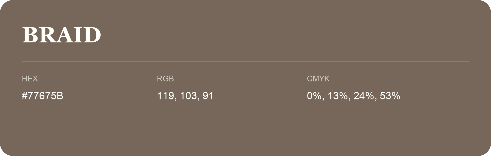

## Braid

- HEX: #77675B
- RGB: 119, 103, 91
- CMYK: 0%, 13%, 24%, 53%
- Character: earthy, rich, warm
- Suggested uses: premium packaging, rustic brands, dark backgrounds

- Source images: iCloud Photos 2/IMG_9122.JPG
