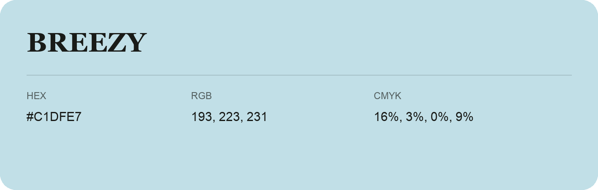

## Breezy

- HEX: #C1DFE7
- RGB: 193, 223, 231
- CMYK: 16%, 3%, 0%, 9%
- Character: soft, gentle, approachable
- Suggested uses: friendly consumer brands, gentle backgrounds, welcoming accents

- Source images: IMG_9044.JPG
